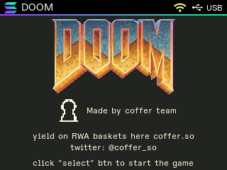
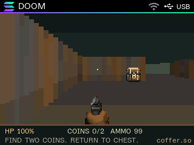
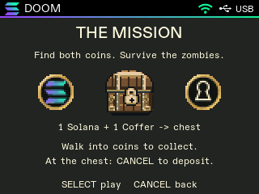
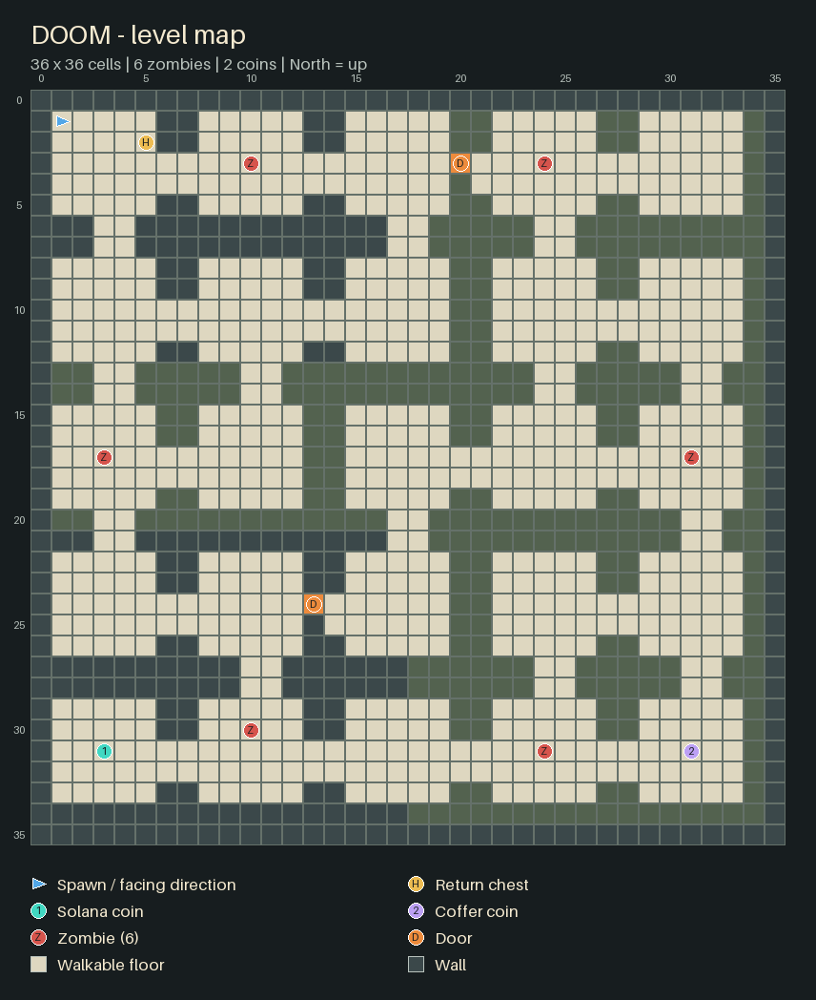
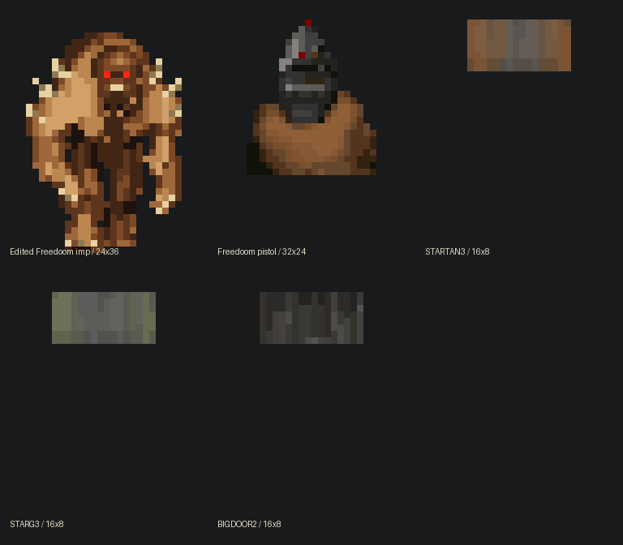

# DOOM — Breakpoint Edition by Coffer

A special edition for [Solana Breakpoint 2026](https://solana.com/breakpoint), made by [Coffer](https://coffer.so) for the Solana badge.

## Two coins. One way home.

You land in a deserted facility. The lights still work. The people don't.

Somewhere beyond the corridors, two coins float above the floor: one Solana, one Coffer. Fight or evade the zombies, collect both, and bring them back to the ornate Coffer chest. Leave either behind and the job isn't finished.

One 36×36 maze: 25 rooms, branching corridors and loops. Physical buttons. No touchscreen controls.

Press SELECT on the title to open the mission guide, then SELECT again to start the game.






Enemies use a brown, red-eyed, spiky imp-style design, adapted from freely licensed historical Freedoom artwork.



## Controls

| Button | Action |
| --- | --- |
| UP / DOWN | Move forward / backward |
| LEFT / RIGHT | Turn; combine with movement |
| SELECT, lower right | Title: mission guide; guide: start; game: fire, hold to keep firing |
| CANCEL, upper right | Interact; hold to pause |
| SELECT / CANCEL in pause | Resume / return to title |
| CANCEL on title / rear BOOT | Exit to Solana OS |

Every game starts through the illustrated mission guide. Coins are collected by walking into them. Bring both back to the chest, face it, and press CANCEL to secure them. SELECT fires with a yellow muzzle flash and weapon recoil.

## RGB reactions

Red flashes when a zombie hits you. Solana and Coffer coins trigger their own colours. Deliver both and the badge celebrates with a rainbow and green victory wave.

## Coffer

Coffer - we generate yield on RWA baskets. APY comes from swaps between the tokens within the basket. Powered by an RWA-first multi-token DEX on solana. We aim to become the main venue for RWA baskets, spot trading, and yield.

[coffer.so](https://coffer.so) · [@coffer_so](https://x.com/coffer_so)

---

## Technical information — install, build and modify

### Install from the Solana OS App Store

Version **1.0.2** is published and listed as **DOOM** in **Games**, ID `doom-by-coffer`. The exact same version is installed and tested on the development badge through USB.

On a [Solana Breakpoint 2026 badge](https://solana.com/breakpoint/badge), connect Wi-Fi, open **App Store**, search **DOOM**, select **DOOM** by **sepezho** (the @coffer_so team) and install it. Open it from **Apps → DOOM**. USB installation is available below.

[DOOM listing](https://solana.com/breakpoint/badge/apps/app?id=doom-by-coffer) · [Solana OS App Store](https://solana.com/breakpoint/badge/apps)

### Build the upload package

The application is Lua. ESP-IDF, a C compiler and replacement firmware are not needed. The App Store compiles the Lua code for the badge when publishing.

```sh
git clone https://github.com/coffer-so/doom-port-to-bp-badge.git
cd doom-port-to-bp-badge
python3 tools/package.py
```

Output: `dist/doom-by-coffer-1.0.2.zip`. Its filename follows the ID and version in `app/app.json`. It contains only the app and its assets, never tests, photographs, credentials or the legacy C engine.

### Install and test over USB

Requires a microSD card and [uv](https://docs.astral.sh/uv/). Target tested: ESP32-C5 badge, Solana OS 2.1.0, 8 MB PSRAM. Earlier builds were also tested on 2.0.0.

```sh
uv run tools/badge.py --port /dev/cu.usbserial-310 info
uv run tools/badge.py --port /dev/cu.usbserial-310 upload app --run
uv run tools/badge.py --port /dev/cu.usbserial-310 run
uv run tools/badge.py --port /dev/cu.usbserial-310 mem
uv run tools/badge.py --port /dev/cu.usbserial-310 shot --shot work/title.png
```

Use your own serial port if it differs (`/dev/cu.usbserial-*` on macOS; `/dev/ttyUSB*` on Linux). Close other serial monitors first. The uploader sends files through the documented Solana OS console and verifies SHA-256; it does not flash or replace Solana OS. Opening the CH340 USB port can reset the badge. The only requested permission is `led`; there is no network, wallet or token access.

### Validate changes

Install Lua 5.5, then run:

```sh
python3 tools/check.py --lua lua5.5
python3 tools/check.py --lua lua5.5 --stress
```

For badge-number precision, build the official Lua 5.5.1 interpreter with 32-bit integers and floats, then pass its path to the checker:

```sh
mkdir -p work/lua32
curl -fL https://www.lua.org/ftp/lua-5.5.1.tar.gz -o work/lua32/lua.tar.gz
tar -xzf work/lua32/lua.tar.gz -C work/lua32
make -C work/lua32/lua-5.5.1 macosx MYCFLAGS=-DLUA_32BITS=1
python3 tools/check.py --lua work/lua32/lua-5.5.1/src/lua --stress
```

Use the Lua make target appropriate for your OS. Tests cover a complete coin-collection route, combat, chest deposit rules, mission UI, lifecycle, RGB effects, native texture cache and crowded render scenes.

### Change the game — people and AI agents

| File | What to change |
| --- | --- |
| `app/game.lua` | Map, zombie behaviour, coin/chest positions and mission rules |
| `app/main.lua` | Title, controls, HUD and renderer |
| `app/art_detail.lua`, `app/coins.lua` | Zombie/chest sprites and branded coins |
| `app/textures.lua`, `app/surfaces.lua` | Prelit materials and bounded native column cache |
| `app/sprites.lua` | Bounded native sprite cache; wall-occluded sprites retain precise clipping |
| `app/rgb.lua` | Damage, collection and victory LED effects |
| `app/app.json` | Permanent ID, display name, version, exact store text and permissions |
| `assets/`, `tools/prepare_art.py` | Editable logo sources and PNG export |
| `assets/freedoom/`, `tools/compile_freedoom.py` | Pinned ready-made sprites/textures, deterministic offline conversion |
| `tools/render_map.py` | Top-down map exported from the actual Lua level |

Rebuild the level map after changing `app/game.lua` (Lua and Pillow via uv):

```sh
uv run tools/render_map.py --lua lua5.5
```

The tool runs `game.lua` through Lua and exports its initial state as text; Python does not parse or evaluate Lua source. The PNG includes the spawn direction, chest, both coins, zombies, doors and a legend. Use `--lua work/lua32/lua-5.5.1/src/lua` for the local 32-bit build above.

The prebuilt artwork is included. To rebuild edited SVGs/logos on macOS:

```sh
brew install cairo ffmpeg
export DYLD_FALLBACK_LIBRARY_PATH="$(brew --prefix)/lib"
uv run --with cairosvg python tools/prepare_art.py
uv run tools/compile_coins.py
python3 tools/package.py
```

`compile_coins.py` turns `assets/solana_coin.svg` and `assets/coffer_coin.svg` into `app/coins.lua`. On Linux, install Cairo and FFmpeg through your distribution; the `DYLD_…` line is macOS only.

Read `AGENTS.md` before automated changes. Edit, run `tools/check.py`, rebuild with `tools/package.py`, then sideload and measure with `lua mem` after returning Home. Use physical keys for held-input tests: console `key` commands inject presses, not button holds. Keep each callback under 200,000 VM instructions and release every app allocation on exit.

For a user-requested release, submit the tested package through [Submit an app](https://solana.com/breakpoint/badge/apps/submit). Future updates keep the same app ID and increment the manifest version. The store runs compilation and review; only an approved listed version appears in search. A linked X account is required for publication.

### Publish source changes to GitHub

With an SSH key already linked to your GitHub account:

```sh
git remote set-url --push origin git@github.com:coffer-so/doom-port-to-bp-badge.git
git add app assets tools tests docs README.md AGENTS.md NOTICE.md
git commit -m "Update DOOM badge game"
git push origin main
```

The App Store upload is a separate step: build `dist/doom-by-coffer-1.0.2.zip`, import it in the submission form, check **Games**, **Listed** and LED-only permissions, then publish. For future releases, increment the version in `app/app.json`, keep ID `doom-by-coffer`, and run `python3 tools/package.py`; the ZIP filename follows the manifest automatically. Use `--out` only to override the output path.

### Architecture and limits

Original Lua raycaster, one 36×36 maze (1,296 cells, 6.6 times the previous 14×14 footprint), six zombies, exactly two coins and one chest. Its 25 rooms connect through two-tile-wide corridors, branches and six large loops. Both coins and the return chest are reachable with both doors closed; the shortest complete route is 130 grid steps. The top-down map above is generated from the same Lua data as the game.

Canvas 160×92 at 2×; 40 wall rays, prelit textures, bounded native wall and sprite caches, and a cheap input tick after three expensive renders. Ray traversal is bounded by the map width plus height. Sprite detail is retained while wall columns use a lower-detail mode. RGB animations update at most 10 times per second. The 1.0.2 Solana OS 2.1.0 startup sample measured **11 FPS** (about 12), render CPU averaging **36 ms** and peaking at **110 ms**. Moving/combat scenes can cost more; the 1.0.1 moving sample measured about 8.5 FPS. These are not identical-camera comparisons. The requested 30 FPS has not been achieved. See `docs/validation.md` for measurements and checks.

This is an original Doom-style adaptation, not the id Software C engine or a WAD-compatible source port. The original Doomgeneric preparation snapshot remains in `vendor/doomgeneric` and is excluded from the application. [Port research](docs/research.md) and [platform details](docs/platform.md) document the alternatives and constraints.

Code, original map and Coffer chest: GPL-2.0-or-later. The brown, red-eyed, spiky enemy is an edited historical Freedoom demon. Pistol and wall artwork: [Freedoom](https://freedoom.github.io/about.html), BSD-3-Clause. These are freely reusable Doom-style assets, not the exact id Software game graphics. Source revisions, licenses, previews and rebuild instructions are in [the artwork guide](docs/assets.md). Brand logos retain their owners' rights. See `LICENSE`, `NOTICE.md` and `app/credits.txt`.

have fun!
