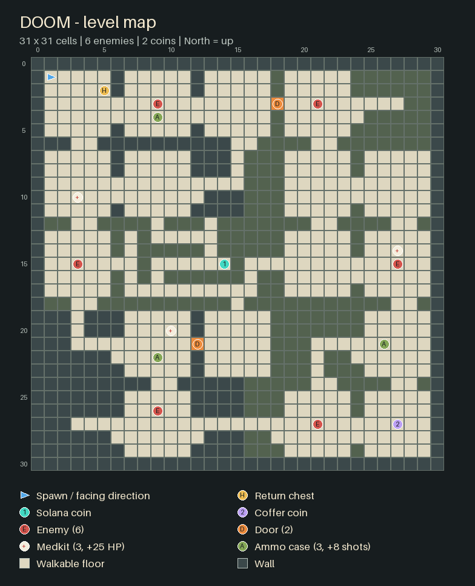

# Level map — 1.0.4



One 31 × 31 level has 17 broad rooms, two-cell corridors, branches and loops,
plus one area of narrow, winding passages. Its 961 cells are about 26% less map
area than the previous 36 × 36 level. The narrow zone occupies zero-based cells
x = 6…18, y = 12…18 and keeps three one-cell dead ends. The Solana coin sits at
(14.5, 15.5) inside one dead end; the Coffer coin is at (27.5, 27.5). Six enemies
guard the two coins. Collect both and return to the ornate chest at (5.5, 2.5).

The map shows the actual initial Lua state: spawn and facing direction, chest,
both coins, all six enemies, three medkits, three ammunition cases and both
closed doors. North is up. Doors are optional
shortcuts; the mission remains possible with both closed.
All 534 initially walkable floor cells remain connected with both doors closed.
The complete coin-and-chest route is 116 grid steps.

Start with 17 rounds and 100 HP. Walk into a white/red medkit to restore up to
25 HP, capped at 100. Walk into an olive ammunition case to gain up to eight
rounds, capped at 99. A supply remains available while that resource is full.
Each enemy hit removes 15 HP.

| Pickup | Initial coordinates |
|---|---|
| Medkits | (3.5, 10.5), (10.5, 20.5), (27.5, 14.5) |
| Ammunition cases | (9.5, 4.5), (9.5, 22.5), (26.5, 21.5) |

Face a nearby closed door to see **“cancel to open the door”**. Press CANCEL to
open it. The prompt requires a reachable door in front of the player; it disappears
when the door opens or the player moves away. Hold CANCEL to pause. At the chest,
face it and press CANCEL to deposit both coins.

Regenerate from `app/game.lua`, rather than editing the PNG:

```sh
uv run tools/render_map.py --lua lua5.5
```

Use `--lua work/lua32/lua-5.5.1/src/lua` for the local 32-bit Lua build. The exporter
runs the Lua simulation, then renders the returned rows and entity coordinates
with the pinned Pillow version. It includes no device state or photographs.
